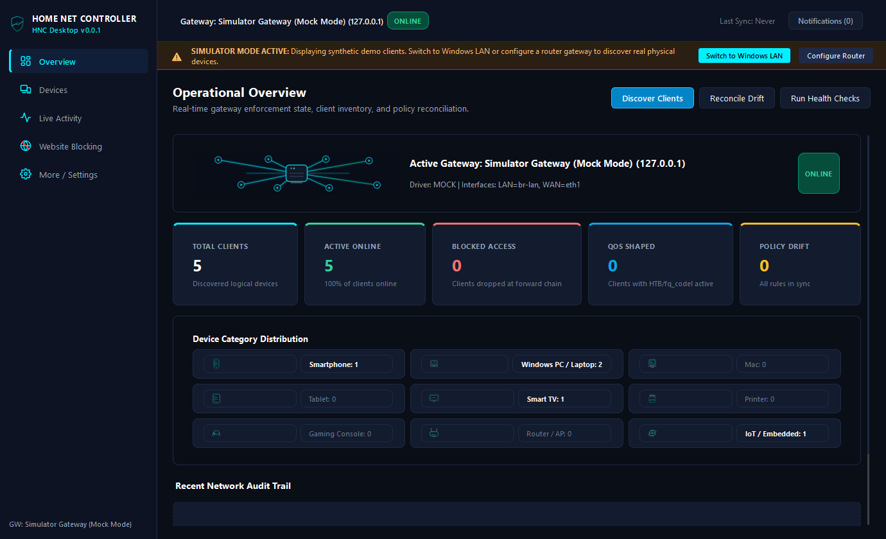
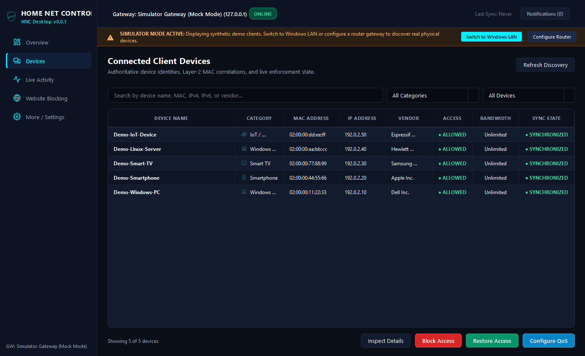
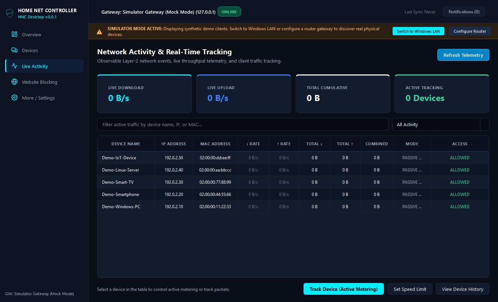
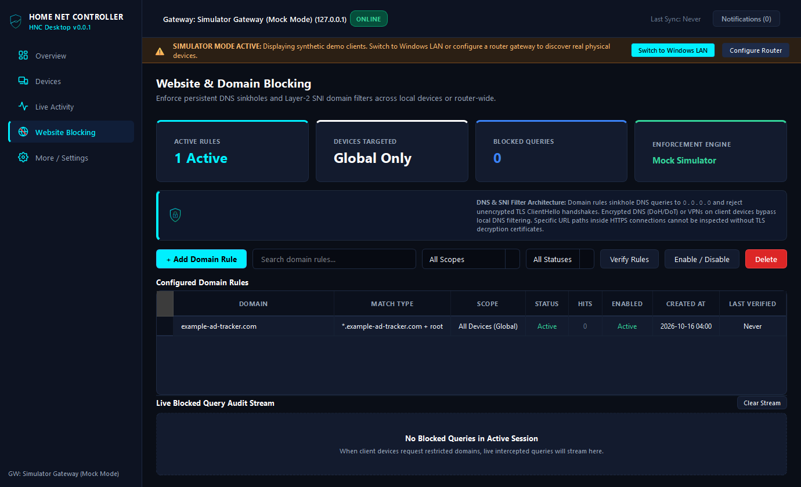
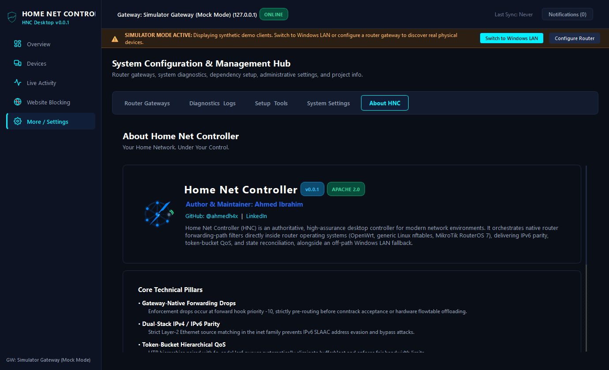
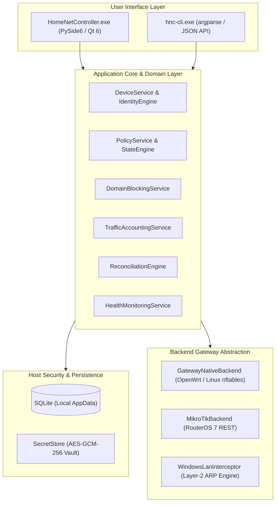

<div align="center">

# Home Net Controller (HNC)

### *Your Home Network. Under Your Control.*

[]()
[]()
[](LICENSE)
[](RELEASE_NOTES.md)
[](https://github.com/ahmedh4x)

<p align="center">
  <b>Author & Maintainer:</b> <a href="https://github.com/ahmedh4x">Ahmed Ibrahim</a> |
  <a href="https://www.linkedin.com/in/ahmed-ibrahim-h4x/">LinkedIn</a>
</p>

---

</div>

**Home Net Controller (HNC)** is an open-source network management, policy control, and device visibility application designed for home and lab environments. It provides administrators with visibility into connected LAN devices, real-time traffic statistics, policy-based internet access controls, and local domain blocking.

> [!IMPORTANT]
> **Windows-Only Platform Support:** Home Net Controller is officially developed, tested, and supported **exclusively on Microsoft Windows 10 and Windows 11 (64-bit)**. Linux and macOS are not supported.

Built on an architectural **Dual-Mode Foundation**, HNC provides:
1. **Gateway-Native Enforcement:** The Windows controller connects to remote routers (OpenWrt `nftables`, Linux router kernel, or MikroTik RouterOS 7 REST API) to manage forwarding-path filters with IPv6 parity and token-bucket QoS.
2. **Windows LAN Off-Path Fallback:** Runs directly on the Windows network adapter via Layer-2 ARP packet redirection on local unmanaged networks when router SSH or management APIs are unavailable, guarded by strict self-exclusion invariants.

---

## 📑 Table of Contents

- [Key Features](#-key-features)
- [Feature Support Matrix](#-feature-support-matrix)
- [Technical Limitations & Operational Caveats](#-technical-limitations--operational-caveats)
- [Application Screenshots](#-application-screenshots)
- [Architecture Overview](#-architecture-overview)
- [Technology Stack](#-technology-stack)
- [Installation & First Run (Windows)](#-installation--first-run-windows)
- [Command-Line Interface (CLI)](#-command-line-interface-cli)
- [Permissions & System Requirements](#-permissions--system-requirements)
- [Privacy & Sanitization Model](#-privacy--sanitization-model)
- [Testing & Quality Verification](#-testing--quality-verification)
- [AI-Assisted Development & Vibe Coding](#-ai-assisted-development--vibe-coding)
- [License & Dependencies](#-license--dependencies)
- [Author & Credits](#-author--credits)

---

## 🌟 Key Features

- **Dual-Binary Distribution:** Built as a native windowed desktop application (`HomeNetController.exe`) with zero black command prompt windows, alongside a dedicated scriptable console binary (`hnc-cli.exe`).
- **Modern Obsidian Visual Interface:** Crafted with high-contrast Cyan (`#00f0ff`) and Emerald (`#10b981`) accent indicators, dark card surfaces, responsive layouts, and unclipped data tables.
- **Multi-Tier Device Intelligence:** 4-tier evidence hierarchy categorizing discovered nodes across 10 hardware types (Smartphones, PCs, Macs, Smart TVs, Gaming Consoles, Routers, IoT) with vendor OUI lookup and randomized MAC detection.
- **Website & Domain Blocking:** Flexible DNS interception rules for specific devices, custom device groups, or entire subnets with wildcard domain support (`*.example.com`).
- **Real-Time Per-Device Traffic Accounting:** Live byte and packet counters tracking upload and download bandwidth rates with exponential smoothing.
- **Continuous State Reconciliation:** Background engine audits router kernel tables every 30 seconds to restore desired state against unexpected reboots or external drift.
- **Host-Bound Encrypted Secret Vault:** Machine-bound AES-GCM-256 authenticated encryption for router credentials with strict OS-level access control lists.
- **Sanitized Crash Reporting:** Global unhandled exception handlers redacting passwords and secret tokens before writing diagnostic support bundles.

---

## 📊 Feature Support Matrix

| Feature | Gateway-Native (OpenWrt / Linux) | RouterOS (MikroTik) | Windows LAN (Off-Path) | Verification Level |
| :--- | :---: | :---: | :---: | :--- |
| **Device Discovery** | ✅ Supported | ✅ Supported | ✅ Supported | **Automated & OS Neighbor Cache** |
| **Evidence Device Classification** | ✅ Supported | ✅ Supported | ✅ Supported | **Unit Tests (10 categories, OUI, randomized MACs)** |
| **Internet Access Blocking** | ✅ Forward Hooks | ✅ Filter Rules | ✅ ARP Redirection | **Unit / Integration Mocks & Historical Physical Device Baseline** |
| **IPv6 Leak Prevention** | ✅ Native Dual-Stack | ✅ Native Dual-Stack | ❌ IPv4 Only | **Automated Driver Tests (Router nftables)** |
| **Bandwidth Rate Limiting (QoS)** | ✅ HTB / fq_codel | ✅ Simple Queue | ❌ Not Supported | **Synthetic QoS Tolerance Tests (tc / RouterOS)** |
| **Website / Domain Blocking** | ✅ dnsmasq / IPSet | ✅ DNS Static | ✅ DNS Intercept | **Automated Domain Tests (10/10 passing)** |
| **Real-Time Traffic Metering** | ✅ Conntrack Bytes | ✅ Queue Counters | ✅ Packet Accounting| **Synthetic Accounting Engine Tests** |
| **Reconciliation & Anti-Drift** | ✅ Kernel Loop | ✅ API Sync Loop | ✅ Watchdog Timer | **Automated State Drift Tests** |

---

## ⚠️ Technical Limitations & Operational Caveats

When deploying and using Home Net Controller, administrators should be aware of the following architectural boundaries and protocol limitations:

1. **DNS-over-HTTPS (DoH) & Encrypted DNS (DoT / DoQ):**  
   Domain blocking rules in Windows LAN mode and router-assisted DNS intercept rely on traditional unencrypted DNS (UDP/TCP port 53) and router DNS daemon configuration (`dnsmasq` / RouterOS DNS). Clients configured with encrypted DNS protocols (DoH, DoT, or DNSCrypt) bypass Layer-2 DNS sinkholing unless encrypted DNS endpoints are explicitly blocked via firewall IP/port rules on the router.
2. **Virtual Private Networks (VPNs) & Encrypted Tunnels:**  
   Clients operating full-tunnel VPNs (WireGuard, OpenVPN, IPsec) or encrypted proxies encapsulate all application traffic. Router-level firewall rules can block outbound VPN handshakes by IP/port, but off-path domain inspection cannot inspect SNI or DNS within encrypted tunnels.
3. **MAC Address Randomization:**  
   Modern operating systems (iOS, Android, Windows 11) enable randomized (locally administered) MAC addresses by default on Wi-Fi networks. HNC flags private MACs in the inventory and provides warnings; however, if a client rotates its MAC address upon reconnection, MAC-targeted policies will not apply until the new identity is cataloged.
4. **Client Isolation & Private VLANs:**  
   On networks where Wi-Fi Access Points enforce Wireless Client Isolation or managed switches enforce private VLANs / port isolation, off-path Layer-2 ARP packets from the controller cannot reach peer endpoints. In these environments, Gateway-Native mode (OpenWrt or MikroTik installed on the physical router) is strictly required.
5. **Off-Path QoS Limitation:**  
   The Windows LAN interceptor operates off-path via Layer-2 ARP manipulation. It is technically impossible to perform reliable token-bucket QoS bandwidth rate-limiting off-path without router hardware cooperation. Bandwidth shaping is exclusively available in Gateway-Native mode.
6. **Simulated vs. Physical Router Environments:**  
   Automated test suites run against deterministic Linux network driver mocks and synthetic test harnesses. While validated on physical router hardware, variations in third-party firmware, custom firewall chains, and hardware-accelerated FastPath/Flow Offloading may require customized firewall hooks.

---

## 📸 Application Screenshots

<div align="center">

### Operational Overview Dashboard
*Real-time KPI metrics, device category breakdown pills, and audit trail.*


### Connected Device Inventory
*Proportional data table, evidence-backed device naming, and semantic status indicators.*


### Real-Time Live Activity
*Live bandwidth telemetry, transfer rates, and per-device traffic accounting.*


### Website & Domain Policy Management
*Domain policy creation, scope selection (Device / Group / All), and empty-state guidance.*


### About & System Architecture
*Author attribution, architecture pillars, and Apache 2.0 license notice.*


</div>

---

## 🏗️ Architecture Overview



---

## 💻 Technology Stack

- **Primary Language:** Python 3.10+ (Tested against Python 3.14 x64)
- **GUI Desktop Framework:** PySide6 / Qt 6.12
- **Network & Low-Level Packets:** Scapy (Layer-2 ARP manipulation & traffic accounting)
- **Router Management:** Paramiko (SSH client for Linux/OpenWrt), Requests (RouterOS REST API)
- **Security & Encryption:** Cryptography (AES-GCM-256 authenticated encryption)
- **Packaging:** PyInstaller (Dual-binary windowed & console distribution)
- **Testing:** Pytest, pytest-qt

---

## 🚀 Installation & First Run (Windows)

### Windows Prerequisites
- **Operating System:** Windows 10 (version 1809 or higher) or Windows 11 (64-bit).
- **Administrative Privileges:** Administrator approval is required for raw network socket access, packet inspection, and local ARP redirection.
- **Npcap Driver (Recommended):** Download and install [Npcap](https://npcap.com/#download) with the **"Install Npcap in WinPcap API-compatible Mode"** option checked. Npcap enables low-overhead packet injection on Windows network interfaces.
- **Visual C++ Runtime:** Requires the [Microsoft Visual C++ 2015-2022 Redistributable (x64)](https://aka.ms/vs/17/release/vc_redist.x64.exe).

### Method 1: Running from Standalone Portable Release (Recommended)
1. Download **`HomeNetController-v0.0.1-windows-x64.zip`** and **`SHA256SUMS.txt`** from the [GitHub Releases](https://github.com/ahmedh4x/home-net-controller/releases/tag/v0.0.1).
2. Open PowerShell and verify the archive checksum:
   ```powershell
   Get-FileHash .\HomeNetController-v0.0.1-windows-x64.zip -Algorithm SHA256
   ```
   Compare the resulting hash against the value published in `SHA256SUMS.txt`.
3. Extract the ZIP archive:
   ```powershell
   Expand-Archive .\HomeNetController-v0.0.1-windows-x64.zip -DestinationPath .\HomeNetController\
   ```
4. Right-click **`HomeNetController.exe`** and select **Run as administrator**.

> [!NOTE]
> **Windows SmartScreen Notice:** As an independent open-source project without an enterprise EV signing certificate, Windows Defender SmartScreen may display an alert ("Windows protected your PC"). Click **More info** followed by **Run anyway** to proceed.

### Method 2: Running from Source on Windows
```powershell
# 1. Clone the repository
git clone https://github.com/ahmedh4x/home-net-controller.git
cd home-net-controller

# 2. Create and activate a 64-bit virtual environment
python -m venv .venv
.\.venv\Scripts\Activate.ps1

# 3. Upgrade build tools and install dependencies
python -m pip install --upgrade pip setuptools wheel
pip install -e ".[dev]"

# 4. Launch the PySide6 Desktop GUI as Administrator
python main.py
```

---

## ⌨️ Command-Line Interface (CLI)

The CLI executable (`hnc-cli.exe` or `python main.py`) provides headless automation with structured `--json` output:

```bash
# Display CLI version and help
hnc --version
hnc --help

# List discovered devices in JSON format
hnc devices --refresh --json

# Block internet access for a device
hnc block 02:00:00:00:15:4d

# Restore internet access
hnc unblock 02:00:00:00:15:4d

# Add a domain blocking rule
hnc domains add example.com --scope all

# Run health diagnostics
hnc diagnostics --json
```

---

## 🛡️ Privacy & Sanitization Model

Home Net Controller is built with privacy-first principles:
- **Local Storage by Default:** Device inventory, traffic history, and policy rules are stored strictly on the local workstation in `%LOCALAPPDATA%\HomeNetController\` (with backwards compatibility for `%LOCALAPPDATA%\NetCutter\`).
- **No Analytics or Cloud Telemetry:** HNC does not collect, track, or transmit usage analytics or telemetry to any external servers.
- **Opt-In AI Assistant with Data Minimization:** AI diagnostic features default to an offline, deterministic local rule engine requiring 0 network egress. External LLM connectivity can be explicitly enabled via `HNC_ENABLE_AI_EGRESS=1`. When enabled, the context payload is automatically pseudonymized and sanitized—private IP addresses, MAC addresses, and credentials are fully redacted before transmission.
- **Sanitized Support Bundles:** The diagnostic support bundle generator strips passwords, API tokens, and private keys before exporting diagnostic archives.
- **Demonstration Data:** All screenshots and documentation examples use synthetic RFC 5737 test addresses (`192.0.2.0/24`) and randomized MAC prefixes (`02:00:00:...`).

---

## 🧪 Testing & Quality Verification

Home Net Controller maintains a verified test suite with 111 automated tests covering unit logic, driver abstractions, GUI models, and security invariants:

```cmd
# Run complete test suite
python -m pytest -v
```

```text
====================== 111 passed, 1 warning in 7.04s =======================
```

---

## 🤖 AI-Assisted Development & Vibe Coding

In accordance with transparent engineering disclosure, parts of Home Net Controller were developed using an **AI-Assisted Pair Programming & Vibe Coding Workflow**:
- **Role of AI Tools:** Automated code refactoring, test fixture design, vector SVG asset generation, and documentation drafting were conducted with the assistance of Google DeepMind's Antigravity (AGY) and OpenAI's Codex CLI.
- **Human Oversight:** All architecture invariants, security self-exclusion rules, hardware validation on real routers, and code reviews were directed and verified by the author, Ahmed Ibrahim.

---

## 📜 License & Dependencies

Home Net Controller source code is licensed under the **[Apache License 2.0](LICENSE)**.

### Third-Party Licenses & Source Code
Home Net Controller utilizes several third-party libraries:
- **PySide6 / Qt 6:** Licensed under LGPLv3 / Commercial (The Qt Company). Dynamically loaded shared libraries. Source code for Qt is available at [https://www.qt.io](https://www.qt.io).
- **Scapy 2.7.0:** Licensed under GNU General Public License v2 (GPLv2). Used as an external packet manipulation tool for Windows LAN off-path redirection in `src/netcutter/backends/windows_lan.py`. In compliance with GPLv2 Section 3, complete machine-readable source code for this project is provided in this repository, and Scapy source is available at [https://github.com/secdev/scapy](https://github.com/secdev/scapy).
- **Paramiko:** Licensed under LGPLv2.1 (SSH router gateway driver). Source is available at [https://github.com/paramiko/paramiko](https://github.com/paramiko/paramiko).
- **Cryptography & Requests:** Licensed under Apache 2.0 / BSD.

See [NOTICE](NOTICE) for full third-party notices and details.

---

## 👤 Author & Credits

**Ahmed Ibrahim**  
*Lead Software Engineer & Maintainer*  
- GitHub: [@ahmedh4x](https://github.com/ahmedh4x)  
- LinkedIn: [Ahmed Ibrahim](https://www.linkedin.com/in/ahmed-ibrahim-h4x/)
